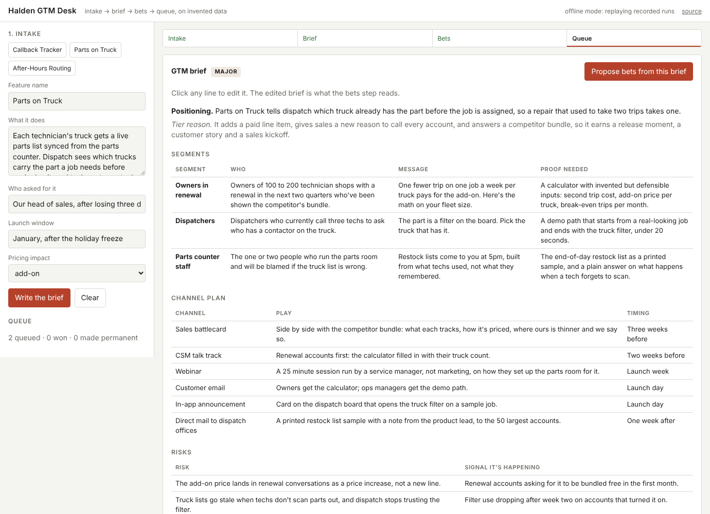
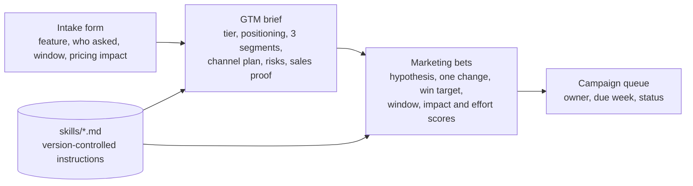

# Halden GTM Desk

A small, hosted demo of the loop I run as a product marketer. A feature comes in. A structured GTM brief comes out. The brief becomes scored marketing bets, and the approved bets land in a campaign queue. It runs in a browser on invented data for a fictional company called Halden, which sells field service software to commercial HVAC contractors. The point is that you can watch the whole workflow run in about three minutes without installing anything.



Everything on the page is made up. No employer's code, customers, numbers or briefs are in here. I rebuilt the pattern from scratch so a reader can watch it run.

## The loop



1. **Intake.** A product manager fills in five fields. Three Halden examples are one click away.
2. **Brief.** The model writes the brief from the intake. It picks a launch tier and gives the reason, writes a positioning sentence a dispatcher could repeat, names three audience segments with the message for each and the proof it needs, lays out a channel plan with timing, lists risks with the signal that each is happening, and ends with what sales will ask for. It renders as a document and every line is editable; the edited brief is what the next step reads.
3. **Bets.** From the brief, four to six bets. Each changes one thing, states a hypothesis, sets a win target before it starts, has a fixed window, and carries a 1 to 5 score on impact and effort. Sorted by impact, then effort.
4. **Queue.** Approved bets go into a queue with an invented owner, a due week and a status. State lives in the browser, so there's no account and no database.
5. **Prompt and skills.** A panel on the page shows the exact system prompt and the skill files the run used.

## Run it locally in ten minutes

```bash
git clone https://github.com/kylewhatnall/halden-gtm-desk
cd halden-gtm-desk
python3 -m venv .venv && source .venv/bin/activate
pip install -r requirements.txt
cp .env.example .env        # optional: add ANTHROPIC_API_KEY for live runs
uvicorn app:app --reload
```

Open http://127.0.0.1:8000. Without a key the app runs in offline mode and replays the three recorded examples, so you can click through the whole loop. With a key it calls the model and streams the output.

Tests run offline by default and never touch the network:

```bash
pip install -r requirements-dev.txt
pytest                 # offline, replays the examples
pytest --live          # adds one real brief and one real bets call
```

## How it's built

- Python 3.11, FastAPI, the Anthropic Python SDK with streaming, and one `index.html` with vanilla JavaScript. No build step.
- `skills/halden_voice.md`, `skills/brief.md` and `skills/bets.md` are the instructions the model loads. To change the output you edit markdown and commit it. The tests check that the recorded outputs follow those rules (tier names, segment counts, no hype words, a win target on every bet).
- `examples/` holds three intakes with their brief and bets. Offline mode replays them; the live test checks that a real call produces the same shape.
- The API key stays on the server. The hosted demo has a daily cap (40 runs by default) and a per-address cap (5 an hour), both set by environment variables. When a cap is hit the page says so and points at the code.
- `render.yaml`, `fly.toml` and a `Dockerfile` cover two hosts. GitHub Actions runs lint and tests on every push.

## Deploy

**Render.** Create a Blueprint from this repo; `render.yaml` defines the service. Add `ANTHROPIC_API_KEY` in the dashboard. The free plan sleeps between visits, which is fine for a demo.

**Fly.** `fly launch --copy-config --no-deploy`, then `fly secrets set ANTHROPIC_API_KEY=...` and `fly deploy`. The config scales to zero when idle.

The caps are there so a stranger can't run up a bill on a public URL. Lower `HALDEN_DAILY_CAP` if you want a tighter ceiling.

## What this is a demo of

I built the production pattern for a software company, and this repo is its shape rebuilt from scratch on invented data. A few things I'd want an operator to notice.

**Intake comes before the brief because the brief is only as good as the question.** Most launch briefs go wrong at the start. Nobody wrote down who asked for the feature or whether it touches pricing, so the brief positions a tier gate as a free improvement and sales finds out on a call. Five fields up front fix most of that.

**The tier decision is the most useful sentence in the brief.** Deciding that something is a quiet release, and saying why, saves more time than any amount of polish on a major launch. The skill file makes the model choose and defend the tier before it writes anything else.

**Bets carry a target before they start.** A campaign that gets measured after the fact can't lose, so it can't teach anything. Every bet here has one change, a number to beat, and a window. In production the queue is where you find out which ones become permanent.

**Prompts are files in the repo.** The instructions are markdown with a diff history. When the output drifts you read the diff. The prompt panel on the page exists so a technical reader can see that without cloning anything.

**What to measure in production.** Time from intake to an approved brief. Share of bets that hit their target. Share of winning bets that become the permanent play. Those three tell you whether the loop is working better than the meetings it replaced.

Design notes and the choices I'd still make differently are in [docs/pattern.md](docs/pattern.md).

## License

MIT. Halden, its products, customers and numbers are fictional.
